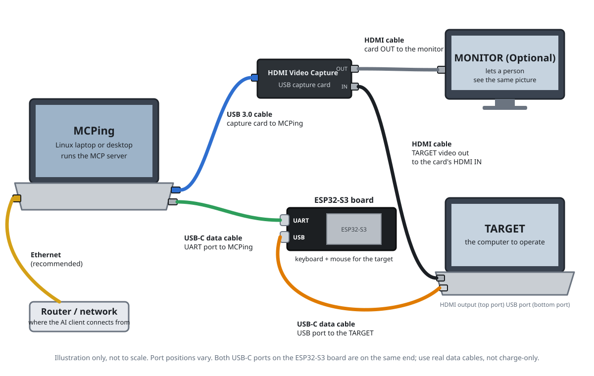

# 1. Overview

> **Non-production, testing only, no warranty.** Read [DISCLAIMER.md](../DISCLAIMER.md) first.

## What it is

The Public Intelligence Node Gateway lets a person, or an AI model, **see and operate another
computer with nothing installed on it**. A small Linux computer, the *MCPing device*, sits between you and
the *target*:

- **Seeing:** an HDMI capture card takes the target's video. Its loop-out passes the picture on to a
  monitor, so a person can watch what the AI sees.
- **Typing and clicking:** a microcontroller (an ESP32-S3 board) plugs into the target's USB port and
  appears as an ordinary keyboard and mouse.
- **The device:** runs the software that captures frames, drives the microcontroller, and offers all of
  it as an [MCP](https://modelcontextprotocol.io) server over HTTPS with a token.
- **Text-only models:** a model that cannot read images gets a plain-text description of the screen,
  made without any AI (OpenCV plus Tesseract OCR).

An AI app (the MCP client) reaches the device over HTTPS with a token. The full cabling is described in
[Build](03-build.md).

## What it is good for
Lawful, supervised work on computers you own or are allowed to control: IT support, setting up or
testing machines, accessibility, and research. See the acceptable use rules in
[DISCLAIMER.md](../DISCLAIMER.md).

## What it cannot do
- It only sees what the target sends over HDMI. Content protected by HDCP appears black.
- It reaches the target only through its screen, keyboard and mouse, but through those it can do anything
  a person at the keyboard could: open files, change settings, send data or spend money. To the target it is
  an ordinary USB keyboard and mouse.
- Reading text is imperfect. Small, dark or low-contrast text is often misread. A model should check
  important details with a screenshot or zoom.
- Typing assumes a US keyboard layout on the target.
- Only one client can drive the device at a time.
- Controlling a target was tested with one Linux computer. Reading the screen was tested on Linux
  screenshots and on a generated Windows test dialog. A real Windows target, a Mac and a BIOS or boot menu
  have **not** been tested, so behaviour there is unknown.

## Status
Experimental. The software was written entirely with AI assistance ("vibe coded") and has not been
independently reviewed or security-audited. The build instructions and both installer scripts have
**not yet been verified end to end** on a fresh machine. Each page says what is and is not tested. A
Claude Code setup skill is included (see the [README](../README.md)); it is as untested as the rest.

## Similar projects
For real work, use an established network KVM such as PiKVM or JetKVM. They are built for a human
operator and are not replaced by this project. What differs here is that the client is an MCP-speaking AI
model, and that models that cannot read images get a text description of the screen.

## Reading order
Read these two first, before building or connecting anything:
- [DISCLAIMER.md](../DISCLAIMER.md): authorised use, ethics, no warranty.
- [SECURITY.md](../SECURITY.md): what the token can do, and never exposing the device to the internet.

Then, in order (the numbers match the page titles):
2. [Parts](02-parts.md)
3. [Build](03-build.md)
4. [Device setup](04-device-setup.md) (includes the untested installer script)
5. [Firmware](05-firmware.md)
6. [Connect a client](06-connect.md)
7. [Using it](07-using.md)
8. [Troubleshooting](troubleshooting.md)
