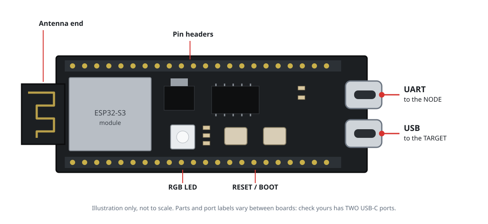
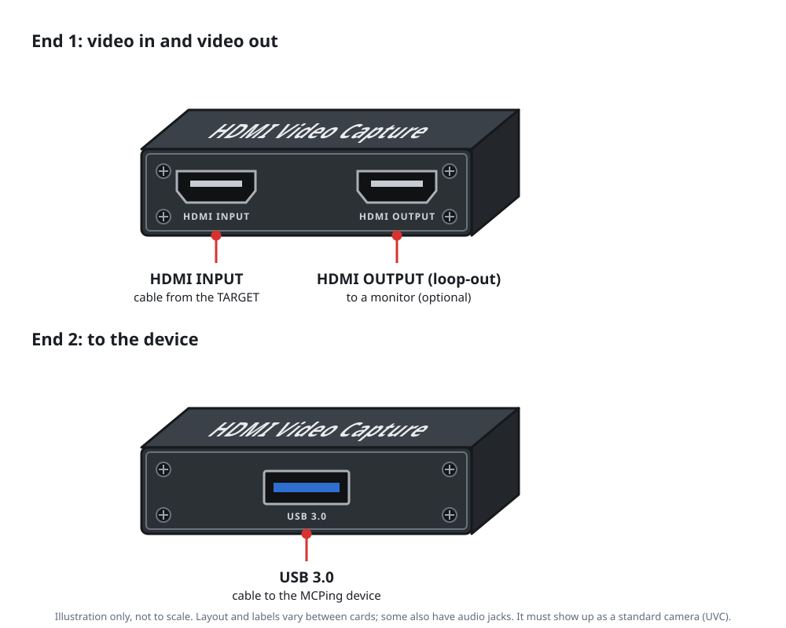

# 2. Parts

> **Non-production, testing only, no warranty.** Read [DISCLAIMER.md](../DISCLAIMER.md) first.
> Prices and availability change, so none are listed. Buy from sellers you trust, and use power
> supplies that are certified for your region.

## The tested set
Only these have been used with this software. Anything else is untested.

| Part | What to look for | Notes |
|---|---|---|
| **Node computer** | A Linux computer (laptop, desktop or any other machine) that runs Linux Mint 22.x or Ubuntu 24.04 on x86-64 or ARM64, with at least 3 USB ports (one USB 3), wired Ethernet, Wi-Fi, 4 GB RAM and 32 GB storage. | Best suited to a computer that is easy to carry to the destination with little effort. |
| **Microcontroller board** | ESP32-S3 development board with **two USB-C ports**, such as an ESP32-S3-DevKitC-1 (N16R8 tested). | One port is a USB-serial chip (talks to the node and powers the board). The other is the chip's native USB (goes to the target). A board with only one port will not work. |
| **HDMI capture card** | USB 3 capture card with an **HDMI loop-out** that shows up as a standard camera (UVC). An MS2130-based card was tested. | Other chips need their own brightness and contrast values (see [Build](03-build.md)). |
| **Cables** | 2 HDMI cables, 2 USB-C cables (a data cable from the node to the ESP32, and one from the ESP32 to the target), and a USB cable for the capture card. | Use real data cables, not charge-only. |
| **Monitor** (optional) | Any HDMI monitor. | Plugs into the capture card's loop-out so a person sees the same picture. |

## What to look for
The pictures below are simple drawings, not product photos, because the rights to photos belong to the
sellers and makers. Your parts will look different. Check the port counts and labels against the table
above before you buy.

**Microcontroller board: it must have two USB-C ports** (an ESP32-S3 board). Boards from the plain
ESP32 family, boards with one micro-USB port, and boards with one USB-C port will not work. A
photo with every part labelled is in the maker's
[ESP32-S3-DevKitC-1 documentation](https://docs.keyestudio.com/projects/ESP32-S3/en/latest/)
(an example of the right kind of board, not an endorsement). On that board the two ports are
labelled **USB-to-UART** and **USB OTG**:

| This guide calls it | Some boards label it | It connects to |
|---|---|---|
| the **UART** port | USB-to-UART, COM | the **node** (commands and power) |
| the **USB** port | USB OTG, USB | the **target** (keyboard and mouse) |

**HDMI capture card: it needs a loop-out** as well as the HDMI input, a USB connection to the node,
and it must appear as a standard camera (UVC).

**Node computer: three or more USB ports, one of them USB 3.**

## Node computer notes
- **Wired Ethernet is strongly recommended.** Use Wi-Fi only if you have to.
- If a computer's Wi-Fi card repeatedly disappears from the system, treat that as suspect hardware
  and use a wired connection or a different adapter, rather than tuning around it.
- Use the power adapter that came with the computer.
- Disable sleep and make the power button harmless, because a node that suspends drops the target.

## Target computer
Needs a video output you can plug into the capture card and a USB port for the ESP32. The ESP32
presents a keyboard and an absolute-position mouse. Whether a particular BIOS accepts it is untested.

## Not provided
No enclosure, stand or 3D-printable parts are provided with this project. Mount and protect the
boards yourself, keep them away from heat and liquids, and avoid shorting the pins on the ESP32 board.

## Next
[Build](03-build.md)
